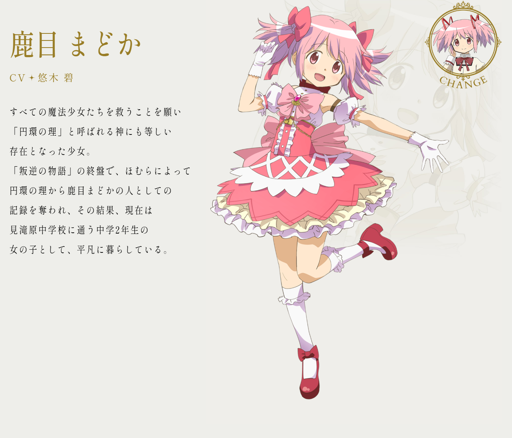
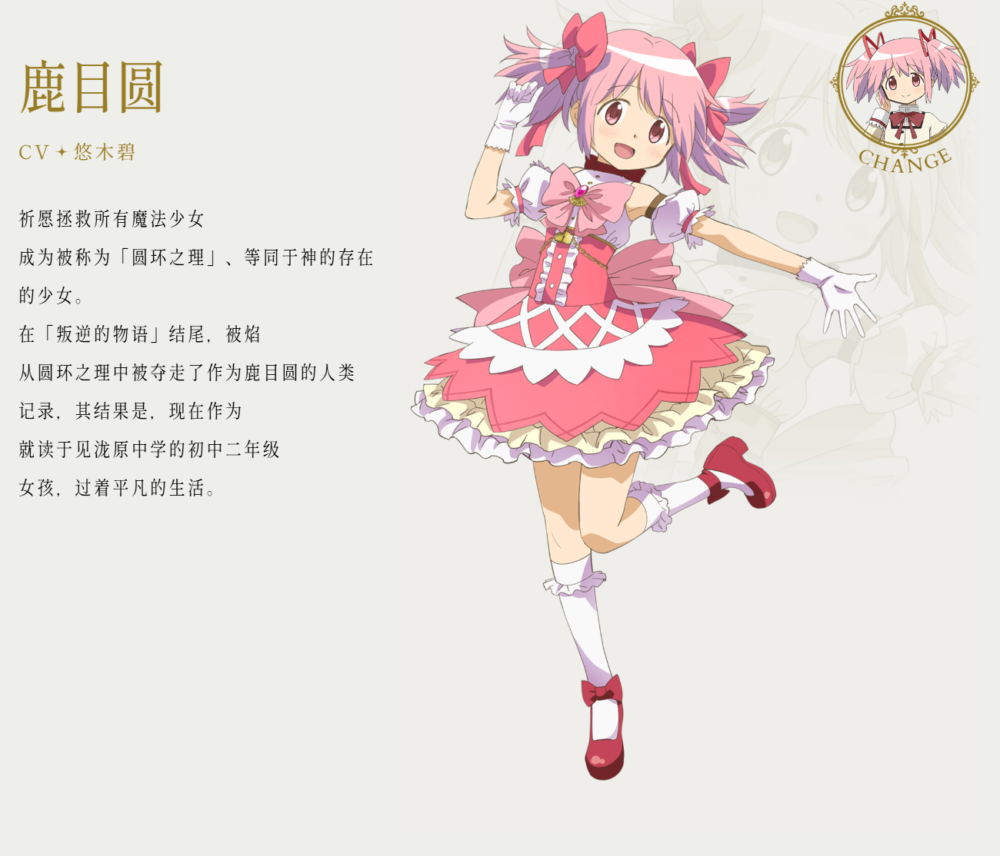
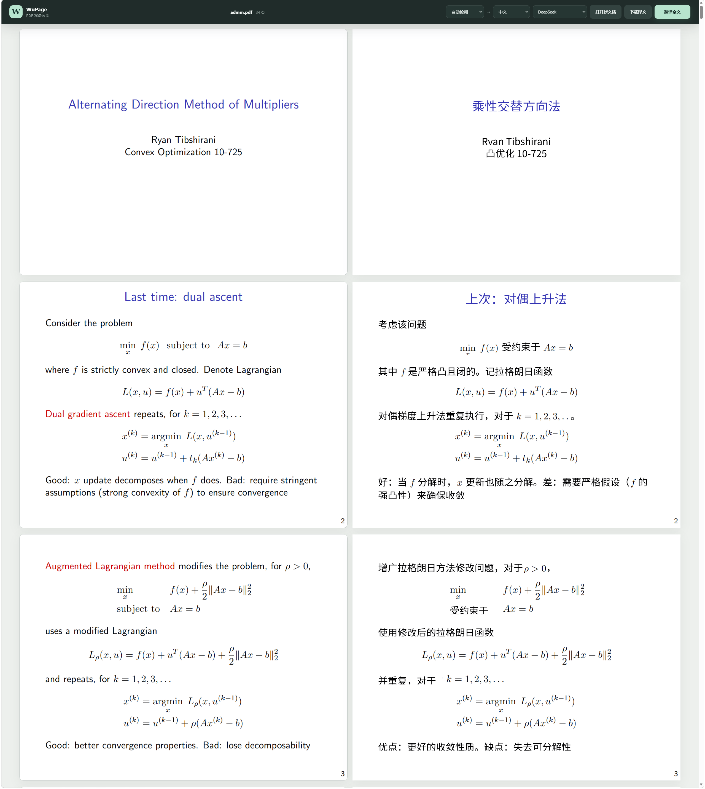

  
  <h1>WuPage Translator</h1>
  
适用于 Microsoft Edge 和 Chrome 的网页、图片与 PDF 翻译扩展。

  
支持全文翻译、段落翻译、双语对照和 PDF 译文编辑，可配置多种翻译服务。

  

    <a href="https://microsoftedge.microsoft.com/addons/detail/wupage-translator/ophhojnppohaklhcdaheplkodopmplfg">Microsoft Edge 插件商店</a> ·
    <a href="https://github.com/mr-wuliu/wupage/releases/latest">下载发布包</a> ·
    <a href="https://wupage.mrwuliu.top/">项目主页</a> ·
    <a href="https://github.com/mr-wuliu/wupage/issues">问题反馈</a> ·
    <a href="PRIVACY.md">隐私政策</a>
  

  

    
  

[效果预览](#效果预览) · [安装](#安装) · [网页翻译](#网页翻译) · [图片翻译](#图片翻译) · [PDF 翻译](#pdf-翻译) · [翻译服务](#翻译服务) · [故障排查](#故障排查)

## 效果预览

**原文替换 · 日语 → 简体中文**

| 原文 | 译文 |
| --- | --- |
|  |  |

## 安装

### Microsoft Edge

1. 打开 [WuPage Translator 商店页面](https://microsoftedge.microsoft.com/addons/detail/wupage-translator/ophhojnppohaklhcdaheplkodopmplfg)。
2. 点击「获取」，按提示完成安装。
3. 在浏览器扩展菜单中，将 WuPage 固定到工具栏。

### 手动安装（Chrome / Edge）

1. 从 [Releases](https://github.com/mr-wuliu/wupage/releases/latest) 下载 `wupage-<version>-edge.zip`。
2. 解压发布包，保留解压目录。
3. 打开扩展管理页：Chrome 使用 `chrome://extensions`，Edge 使用 `edge://extensions`。
4. 开启「开发人员模式」，点击「加载已解压的扩展程序」或「加载解压缩的扩展」。
5. 选择包含 `manifest.json` 的解压目录。

Chrome 与 Edge 使用同一发布包。手动更新时，将新版文件解压到原安装目录并替换旧文件，然后在扩展管理页重新加载扩展。

安装或更新后，刷新已打开的网页。

## 网页翻译

### 全文翻译

1. 打开网页，点击工具栏中的 WuPage 图标。
2. 设置源语言、目标语言和翻译服务。
3. 点击「翻译全文」，在当前页面查看译文。
4. 点击「显示全文」，恢复原文。

初始配置为自动检测源语言、翻译为简体中文，使用无需 API Key 的 Google Web Translate。页面默认同时显示原文与译文；滚动或异步加载的新内容会继续识别并翻译。

### 显示模式

在扩展弹窗的「显示模式」中选择：

| 模式 | 显示方式 |
| --- | --- |
| 译文替换 | 隐藏原文，在原页面中显示译文 |
| 原色对照（默认） | 在原文下方显示译文，沿用原文颜色 |
| 双色对照 | 在原文下方显示译文，以相近颜色区分 |

### 段落翻译

1. 在扩展弹窗中开启「段落模式」。
2. 按住 `Ctrl`，点击需要翻译的段落。
3. 使用结束后，关闭「段落模式」。

### 悬浮球

在扩展弹窗中开启「悬浮球」，通过网页内的悬浮控件访问常用翻译操作。关闭该选项可隐藏控件。

## 图片翻译

### 安装识别模型

1. 在弹窗或设置中，点击「图片翻译」旁的扳手图标。
2. 等待约 20.5 MB 的文字识别（OCR）模型下载、校验和安装完成。
3. 开启「图片翻译」。

安装在后台进行，关闭弹窗不会中断。将鼠标移到「？」上可查看下载进度和安装状态；安装失败时，点击扳手重试。

### 翻译与切换

1. 将鼠标移到网页图片上，点击「译」；也可右键点击图片，选择「使用 WuPage 翻译图片」。
2. 识别完成后，译文覆盖在原图的文字区域。
3. 点击「原」查看原图，点击「译」恢复译图。

文字识别在本地完成，翻译服务仅接收识别出的文字。原始图片文件和链接保持不变。

### 支持范围

- 识别语言：简体中文、繁体中文、英文和日文。
- 图片类型：网页中的静态图片；动画、CSS 背景图及嵌入框架内部图片暂不保证支持。
- 文件大小：下载上限为 12 MB，超大图片会缩放后识别。
- 访问条件：图片地址须可访问；鉴权、防盗链或特殊地址可能导致读取失败。
- 显示效果：纯色背景较适合覆盖译文；复杂纹理、艺术字、竖排、低对比度和密集小字可能出现识别或定位偏差。

### 模型与缓存

关闭「图片翻译」会移除译文覆盖层，保留本地模型。点击旁边的垃圾桶可删除模型并关闭该功能。

开启缓存后，仅保存识别出的文字区域和译文，不保存原始图片。「清除缓存」删除翻译结果，不删除 OCR 模型。

图片文字的识别与显示说明

译文按识别位置覆盖，纯数字、百分比、倍率和常见数量缩写保持原样。覆盖区域使用从图片中采样的背景色，透明图片保留透明度与原文字颜色；复杂背景不进行无痕修复。

宽幅透明文字图中，同一行的相邻片段会合并翻译，并尝试补全覆盖范围内遗漏的标点。识别失败、无可翻译内容或译文未变化时，页面会显示相应提示；空结果不写入缓存。

全文翻译还会读取网页图片提供的长段替代文字（`alt`），无需 OCR。能够识别段落间隔的透明文字图片，可按段显示原图文字与对应译文；「译文替换」模式仅显示译文。其他图片保留原图，在下方显示翻译后的说明。恢复原文时还原原图。

## PDF 翻译

### 效果预览

英文 → 简体中文，左侧为原文，右侧为译文。

### 打开文档

1. 在浏览器中打开 PDF。
2. 点击 WuPage 弹窗中的「翻译 PDF」，进入双栏工作区并开始翻译。
3. 在工作区中，可通过选择文件、拖放文件或粘贴 PDF 地址打开其他文档。

### 校对与导出

工作区按页对齐显示原文与译文。译文块支持直接编辑、移动、缩放和删除。完成校对后，下载当前版本的译文 PDF。

本地文件访问权限

直接读取浏览器中已打开的本地 PDF，需要在扩展详情中开启「允许访问文件网址」或「允许访问文件 URL」。在工作区选择或拖放文件，不需要此权限。

开启权限后，点击工作区中的「重试打开」。如果浏览器重载扩展并关闭了工作区，返回原 PDF 标签页，再次点击「翻译 PDF」。

### 使用限制

- PDF 须包含可提取的文字，当前不支持纯图片或扫描版文档。
- 复杂表格、特殊字体和高度图形化的版面可能需要手动校正。
- 导出的页面会被扁平化，以保持字体与版式一致；文字不可选择或搜索。

## 翻译服务

点击扩展弹窗中的「设置」，配置翻译服务；完成后返回弹窗，在「翻译服务」中选择对应项目。

| 服务 | 所需配置 |
| --- | --- |
| Google Web Translate | 无需密钥，默认启用 |
| Microsoft Translator | Azure Translator API Key，部分资源需要填写区域 |
| Google Cloud Translation | Google Cloud API Key |
| DeepSeek / Zhipu GLM | 对应平台的 API Key 和模型 |
| OpenAI Compatible | 服务地址、模型及服务要求的 API Key；支持兼容接口的本地服务 |
| Anthropic Compatible | 添加自定义 LLM 服务，填写服务地址、模型及所需密钥 |
| HTTP Template | 接口地址、请求参数和响应格式 |

Google Web Translate 使用非官方网页接口，可能受到限流、地区限制或接口变更影响。第三方服务的可用性、用量限制和费用以服务商为准。

高级配置：LLM 服务、Ollama 与 HTTP 模板

### LLM 服务

DeepSeek 内置预设使用官方 API，并默认关闭思考模式以减少翻译延迟。OpenAI Compatible 适用于 OpenAI、兼容 `/chat/completions` 的网关，以及其他采用相同请求格式的服务。Anthropic Compatible 支持 Messages API 格式。这些 LLM 服务都可以自定义 Base URL、API Key、模型与系统提示词。

LLM 返回值应为与输入顺序一致的 JSON 字符串数组。只有一个输入项时，也兼容单个字符串结果。

使用 Ollama 等本地 OpenAI 兼容服务时，Base URL 填写到 `/v1` 即可，例如 `http://[IPv6地址]:11434/v1`，扩展会追加 `/chat/completions`。如果 Ollama 返回 403，请按 [Ollama 官方说明](https://docs.ollama.com/faq#how-can-i-allow-additional-web-origins-to-access-ollama) 配置 `OLLAMA_ORIGINS`，允许当前扩展的来源。Windows 可执行 `setx OLLAMA_ORIGINS "chrome-extension://扩展ID"`，然后完全退出并重新启动 Ollama。扩展 ID 可在浏览器扩展管理页查看；需要允许所有 Chromium 扩展时可使用 `chrome-extension://*`。

### HTTP 模板

模板中可以使用以下占位符：

| 占位符 | 内容 |
| --- | --- |
| `{{targetLang}}` | 目标语言代码 |
| `{{sourceLang}}` | 源语言代码，自动检测时为 `auto` |
| `{{texts}}` | 输入文本的直接表示 |
| `{{json texts}}` | JSON 编码后的输入文本数组 |

「响应路径」必须指向一个字符串数组，数组顺序和数量需要与输入文本一致。

## 故障排查

| 现象 | 处理方法 |
| --- | --- |
| 点击全文翻译无响应 | 确认当前为普通网页；浏览器设置页和扩展内部页面不支持全文翻译。安装或更新后，刷新页面重试 |
| 翻译请求失败 | 检查网络、服务地址、密钥和用量限制；在弹窗的 Debug 面板查看错误信息 |
| 默认翻译服务不可用 | 检查网络，或切换到已配置的其他翻译服务 |
| 图片翻译开关不可用 | 等待 OCR 模型安装完成；安装失败时点击扳手重试 |
| 本地 PDF 无法打开 | 开启文件访问权限后重试，或在工作区中选择、拖放文件 |

## 隐私说明

翻译请求由扩展直接发送至所选服务商。WuPage 不提供翻译代理或分析服务；API 凭据、扩展设置和可选翻译缓存保存在浏览器本地。

网页、PDF 及图片中识别出的待翻译文字会交由所选服务商处理。翻译敏感内容前，应确认相应服务商的隐私条款。完整说明见 [隐私政策](PRIVACY.md)。

## 问题反馈

通过 [Issues](https://github.com/mr-wuliu/wupage/issues) 提交问题或功能建议。问题报告应包含：

- 浏览器和 WuPage 版本；
- 使用的翻译服务；
- 复现步骤及可公开访问的页面或最小示例；
- Debug 面板中的错误信息。

提交前移除密钥和敏感文本。代码改进可通过 Pull Request 提交。

## 开发文档

源码构建、测试与项目结构说明见 [开发指南](docs/development.md)。
